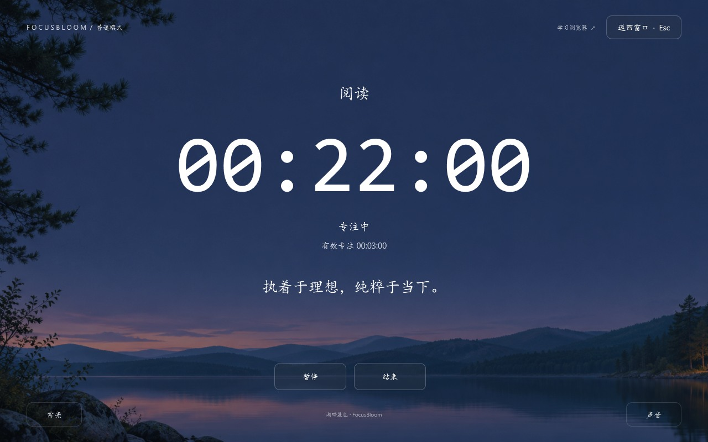
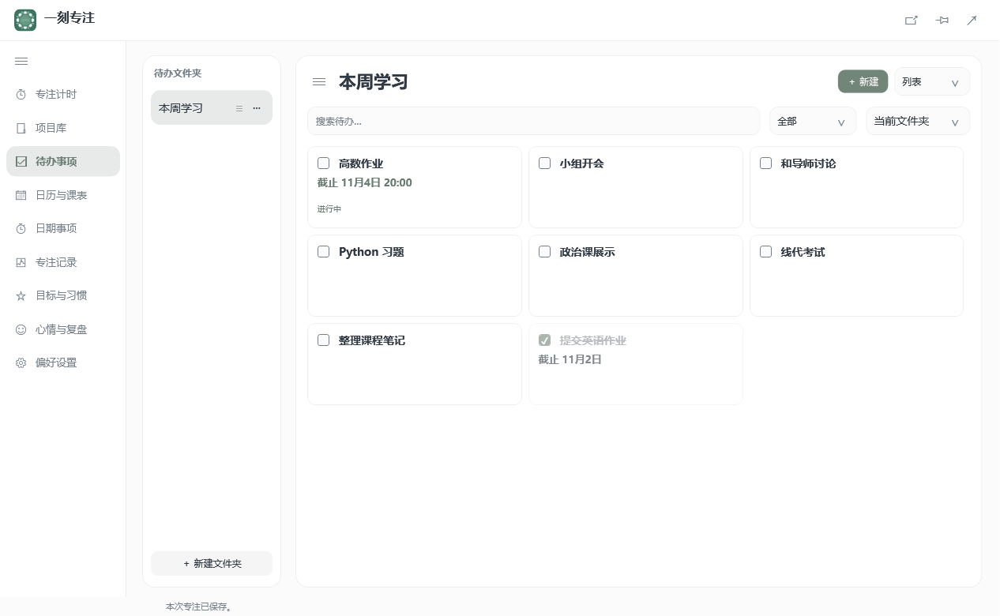
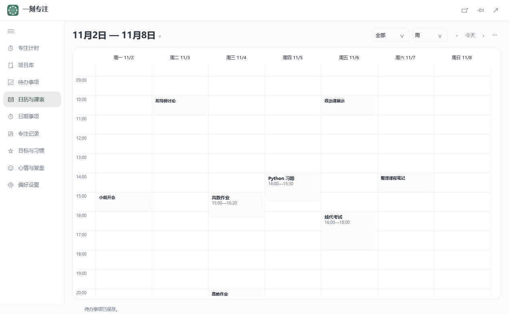
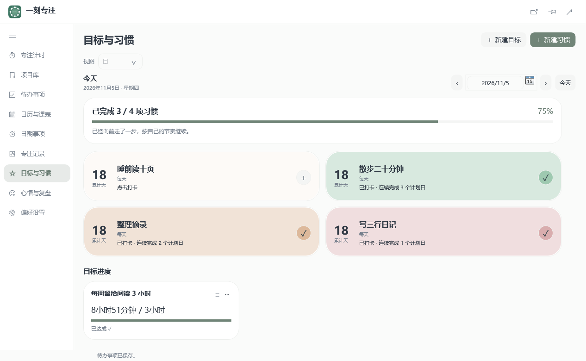
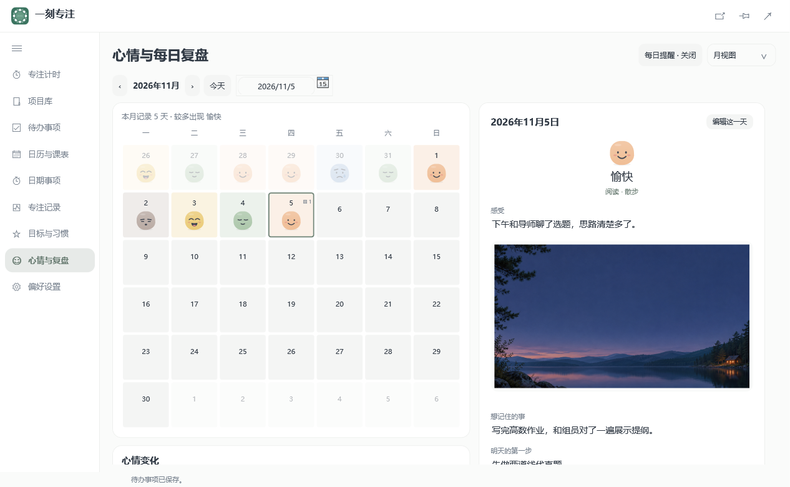
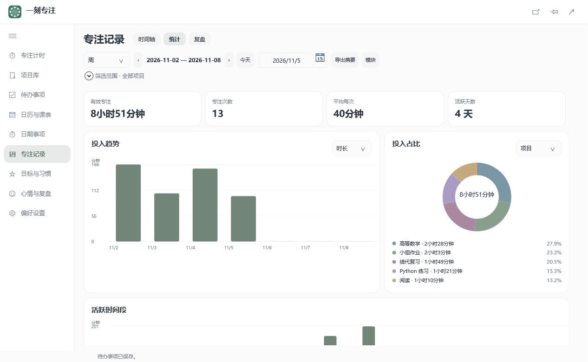

# 一刻专注 · FocusBloom

一刻专注是一款 Windows 专注与学习管理软件。把一个项目拆成待办，排进日历，从任务直接开始计时。开启严格模式后，可以按自己设置的名单限制其他软件的使用。结束后可以回看投入了多久、完成了什么，以及下次从哪里继续。

Windows x64 · 离线版 · 无需注册

## 下载与运行

1. 打开 [GitHub Releases](https://github.com/Amy22707/FocusBloom/releases)，在 **Assets（资源）** 中下载 `FocusBloom-Windows-x64.msi`。
2. 双击 MSI，按向导选择安装位置和是否创建桌面快捷方式。安装后可从开始菜单打开 FocusBloom，也可在完成页选择启动。
3. 在「待办事项」创建一条任务，打开详情并选择「开始专注」。结束后，到「专注记录」查看投入、补记成果和下一步。

安装包内含 .NET 桌面运行时。安装包尚未签名，Windows 可能显示发布者提示。

内置学习浏览器需要 Microsoft Edge WebView2 Runtime。Windows 11 随系统预装，绝大多数 Windows 10 设备也已安装，通常可直接使用。访问网页需要网络。

如果内置浏览器提示缺少运行时，可前往[微软官方下载页](https://developer.microsoft.com/en-us/microsoft-edge/webview2/#download-section)手动补装 Evergreen WebView2 Runtime。

## 功能

- **专注计时** · 正计时、倒计时和番茄循环，支持暂停、中断恢复、全屏、置顶浮窗，以及自定义背景、文字和声音。
- **自定义软件使用限制** · 在「偏好设置 → 严格模式规则」添加应用。黑名单只限制名单中的应用，白名单只允许名单中的应用，系统必要应用会自动放行。开始严格专注后生效，暂停期间继续限制，休息或结束时解除。也可为内置学习浏览器单独设置网站规则。
- **项目与待办** · 用项目预设生成可编辑的待办，给任务拆子任务、定截止日期或安排时间块。用四象限查看优先级，在项目里看累计投入和剩余预估。
- **电子计划本** · 独立的「计划本」页面保存日、周、月规划。周计划可分到每天，月计划可分到每周，完成后勾选划掉。用日期导航和月历翻看之前的计划。
- **日历与课表** · 在周历或月历查看任务、项目截止和实际投入。支持 CSV 课程导入、多学期切换、日期倒数、系统提醒和 ICS 导出。
- **习惯与心情** · 在日视图一键打卡不同项目。用心情月历回看每天的状态，给复盘加文字和照片。
- **记录与桌面组件** · 按日期和项目回看专注投入、成果与下一步。把计时、日历、习惯等组件放在桌面上。

| 待办分组                                       | 日历安排                                        |
| ------------------------------------------ | ------------------------------------------- |
|  |  |
| **习惯打卡**                                   | **心情月历**                                    |
|  |      |

查看专注统计

## 浏览器扩展

独立扩展支持 Chrome、Microsoft Edge 和 Firefox，提供正计时、倒计时和网站黑白名单。规则、记录和偏好都保存在当前浏览器，无需账号或桌面软件。

- **Chrome / Edge**：从 [Releases](https://github.com/Amy22707/FocusBloom/releases/latest) 下载 `FocusBloom-chromium.zip` 并解压。打开 `chrome://extensions/` 或 `edge://extensions/`，开启开发者模式，再加载包含 `manifest.json` 的文件夹。
- **Firefox 140+**：下载 `FocusBloom-firefox.zip`。打开 `about:debugging#/runtime/this-firefox`，选择「临时载入附加组件」，选中 ZIP。重启 Firefox 后需重新加载。

升级 Chrome 或 Edge 扩展时，将新文件解压到原目录，再在扩展管理页点击「重新加载」，即可继续使用原有记录。[功能展示与安装指南](https://amy22707.github.io/amy-studio/focusbloom/#browser-extension)

## 数据、备份与更新

任务、计时记录、习惯和复盘保存在当前 Windows 用户的本机资料目录。离线版的核心功能无需联网。

- **备份与迁移** · 在「偏好设置 → 数据备份与恢复」导出 `.fbbak` 文件。手动和自动备份均包含自定义背景、声音、句子和复盘照片。换电脑时，在新电脑的同一页面恢复。
- **退出** · 关闭窗口会将软件缩到系统托盘。要彻底退出，请右键托盘图标，选择「退出」。
- **更新** · 先备份并从托盘退出旧版，再运行新版 MSI，或完整解压新版便携 ZIP。程序文件和本机资料分别存放，同一 Windows 用户下重新启动时会继续读取本机资料。

## 反馈与致谢

遇到问题可在 [GitHub Issues](https://github.com/Amy22707/FocusBloom/issues) 反馈。请附上 Windows 版本、软件版本和复现步骤，截图时记得遮盖私人信息。

软件图标由 [@芋鱼_yu](https://xhslink.cn/o/6cydnJJz1q1) 绘制，在此表示衷心感谢。

构建环境与项目结构见[开发文档](docs/development.md)。
