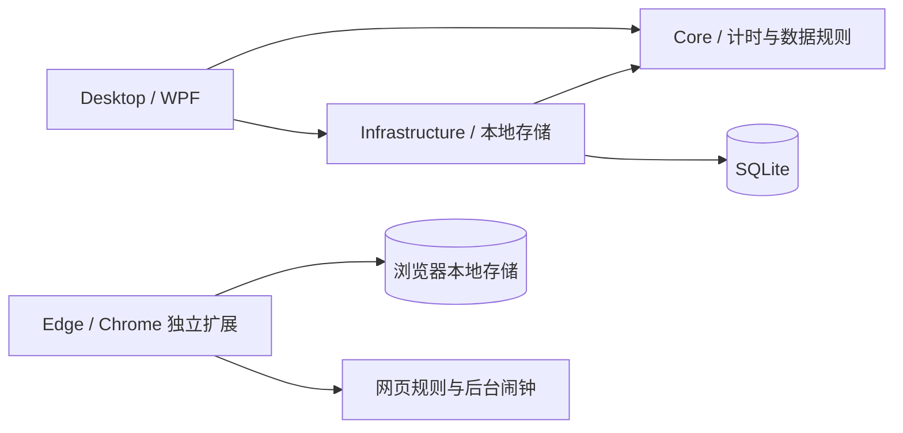

# FocusBloom 工程结构

日期：2026年10月10日

## 依赖方向

桌面应用负责组装具体依赖。Core 不引用 WPF 或 SQLite，包含计时与列表规则；Infrastructure 实现存储接口。界面通过视图模型调用计时核心和存储，窗口布局与计时规则分别维护。浏览器扩展独立保存规则与会话，不依赖桌面程序。

## 已有模块

| 位置 | 职责 |
| --- | --- |
| `Core/Projects` | 项目 ID、名称、分类与颜色 |
| `Core/Focus` | 正／倒计时、番茄循环、暂停、休息、结束状态、专注及暂停区间 |
| `Core/Restrictions` | 网站域名规则、应用放行判断及系统应用例外 |
| `Core/Storage` | 当前项目、记录与设置所需存储接口 |
| `Infrastructure/Storage` | SQLite 建表、项目保存、会话及区间事务保存、设置读写 |
| `Desktop/ViewModels` | 页面状态、命令、输入验证、会话记录保存与重试 |
| `Desktop/Views` | 全屏计时与 WebView2 学习浏览器，共用当前会话及白名单 |
| `Desktop/Presentation` | 视图模型属性通知、按钮命令、配色定义及明暗资源更新 |
| `Desktop/ViewModels/FocusMediaViewModel` | 图片／文字选择、专注图文快照、本机素材偏好与声音控制 |
| `Desktop/Presentation/FocusAudio` | 音频解码、输出、循环与交叉淡化 |
| `Desktop/Views/FocusMediaSettingsView` | 默认折叠的背景／文字／声音素材卡片、收藏、删除、恢复默认及摘录编辑 |
| `Desktop/Views/FocusAudioControls` | 普通页、全屏面板及设置页共用声音控件 |
| `Desktop/ViewModels/FocusTypographyViewModel` | 本机可用字体候选、选择与偏好保存，更新专注字体动态资源 |
| `Desktop/Views/FocusFontSettingsView` | 中文、英文、数字字体卡片及混排预览 |
| `Desktop/Resources/Focus` | 离线背景、环境声、合成音源、提示音及来源目录 |
| `Desktop/Resources` | 共用主题资源与控件样式 |
| `Desktop/Resources/Branding` | 原始 PNG 与多尺寸 Windows ICO，供程序、窗口、托盘及主界面使用 |
| `Desktop/Windows` | 托盘、加载窗口、窗口布局、前台应用监测、应用选择与阻止界面 |
| `Desktop/App` | 数据路径、应用组装、刷新调度、隐藏到托盘与明确退出 |
| `extensions/browser` | 独立 MV3 扩展，计时状态、本地存储、后台闹钟、黑白名单、主题及页面 |

## 计时与数据

状态为准备、专注、暂停、休息、结束。计时读取 `TimeProvider` 的 UTC 时间点，界面每 250 毫秒触发更新；刷新次数不代表经过时间。

暂停到点按预定时刻恢复。倒计时计算扣除暂停后的真实终点；睡眠后首次刷新时，结束记录截止于应结束时刻。休息从会话实际终点开始推进。正计时始终由用户结束，不将 25 分钟解释为自动结束规则。

番茄循环的每轮拥有独立会话ID与记录，计时类型为Pomodoro（枚举值2，原有两种类型的值保持）。专注到点进入短休息，达到配置间隔时进入长休息，最后一轮直接结束；手动结束及退出停止整个循环。休息结束或跳过休息从当前时间开始下一轮，不回填睡眠期间的轮次。完成记录先保存，保存失败时停留在休息，重试成功后继续。每轮开始重新取得应用／网站规则快照并选取图文，暂停恢复保持本轮快照。

循环参数独立保存于settings的`pomodoro.focusMinutes`、`pomodoro.shortRestMinutes`、`pomodoro.longRestMinutes`、`pomodoro.longRestEvery`、`pomodoro.rounds`，保存计时偏好不写入素材设置。运行中的循环使用开始时的参数，偏好修改在下次开始时采用。

会话保存开始／结束、项目、计时类型、结束原因和全部专注／暂停区间。有效时长从专注区间求和，不独立维护另一份统计结果。后续每日时间轴与跨天统计从原始区间拆分。时间以 UTC 时间点存储，界面采用本机本地时间显示。

SQLite 表为 `project_folders`、`projects`、`sessions`、`intervals`、`settings`。会话与区间使用一个事务保存，相同会话 ID 重复保存不重复增加记录。保存失败时保留内存记录，禁止新会话覆盖，记录页可重试；明确退出仅在保存成功后执行。

项目库修改窗口支持文件夹改名、项目改名与移动；项目 ID 保持不变。新建、改名和移动校验文件夹及同文件夹内项目重名，忽略首尾空格与英文大小写。文件夹改名在事务中更新文件夹和活动项目分类，删除文件夹在事务中移除文件夹并标记其中项目删除。`projects.deleted` 保存删除状态，活动列表过滤已删除项目，记录列表读取全部项目名称，历史会话外键及区间保留；已有项目表启动时补充此字段。最后一个项目可删除并保留空文件夹，正在计时或记录未保存时点击删除则显示只有“知道了”的提示，不进入删除确认。

当前文件夹与项目 ID 以一组 JSON 保存于 `focus.selection`。启动按有效项目 ID 定位当前文件夹，找不到项目时保留有效文件夹并选择其中可用项目；两者均不可用时采用首个可用文件夹。空文件夹选择保存为空项目，启动不会被历史记录覆盖。没有该偏好时，最近一次专注记录作为初始选择依据。

文件夹名称与项目ID顺序保存于 `projects.order`，素材ID顺序保存于 `focus.media` 的 `ImageOrder`、`QuoteOrder`、`SoundOrder`。集合使用Move更新，保留对象、缩略图缓存和当前选择；名称修改保留位置，新增项追加，项目移动到其他文件夹后追加到目标末尾。`ReorderButton`提供无边框手柄、同列表拖放、跟随鼠标的静态卡片预览、170毫秒让位动画、边缘滚动及首尾／相邻菜单，拖放与菜单共用模型排序方法。计时下拉框与声音选择列表同步集合顺序。

项目按一层文件夹组织，项目的 `Category` 为所属文件夹名称；`project_folders` 保存独立创建的空文件夹。读取文件夹时同时采用已保存文件夹与已有项目分类，原有项目及历史记录保留相同 ID。

会话的 `strict` 字段保存普通／严格模式；已有数据库增加这一列并将历史记录保持为普通模式。应用和网站各自保存黑白名单模式与两种独立列表，新会话复制所选模式及列表形成快照。`FocusTimer.RestrictionsActive` 仅在严格专注和暂停为真，休息与结束为假。

扩展在 `chrome.storage.local` 保存计时偏好、两种网站列表和当前会话。会话包含真实时间点、累计有效专注、暂停／休息终点及网站快照，状态从当前时间计算。后台闹钟唤醒处理自动恢复及到点结束；每次后台启动、面板请求或网页事件先补齐到期状态。工具栏面板、专注标签页与阻止页共用背景服务中的同一会话，状态视图放入 `chrome.storage.session`。

扩展使用动态网络规则处理顶层页面：白名单默认重定向、列表内高优先级放行；黑名单仅重定向列表内域名。已有标签页同步检查；暂停保持限制，休息／结束或关闭限制开关清除规则并恢复阻止页原网址。图片、脚本、样式、接口及下载等资源继续运行。网站配置写入浏览器本地存储，专注／暂停期间拒绝规则编辑。动态规则跨浏览器重开保留，后台恢复时按会话有效期更新。

常亮服务在 UI 线程调用 `SetThreadExecutionState`，专注及暂停期间按开关申请显示与系统运行请求，休息、结束、关闭开关及退出释放。该请求不阻止屏保或系统策略自动锁屏。

应用限制使用 WinEvent 前台事件与界面刷新检查，普通应用匹配真实进程路径，商店／MSIX应用按包名、发行者ID和包内相对程序路径匹配，版本目录变化后沿用原黑白名单。阻止窗口覆盖目标屏幕并取得前台焦点，提示显示期间不改变受限窗口状态。开始严格限制时记录已有窗口，点击“返回专注”将已有可见窗口最小化、隐藏窗口恢复隐藏，并对新打开窗口发送正常关闭请求；新窗口所属软件按自身关闭规则退出或回到托盘。后台进程不强制终止。阻止窗口提供返回及结束入口；自有窗口、其拥有的对话框及必要系统界面放行。退出时取消监测并关闭阻止窗口。

学习浏览器使用独立 WebView2 用户目录保存本机登录状态，标签页共用环境与当前白名单。导航及重定向检查主页面，弹窗进入同一环境的新标签页，开始严格专注时检查全部已有标签页。阻止界面隐藏网页控件，解除限制后恢复请求；资源请求保持加载，未放行的嵌入页面取消导航。

界面采用侧栏导航、文件夹列表、项目卡片和独立计时区域。计时方式下拉列表直接选择 `TimerMode`。控件颜色与渐变从应用动态资源取得，配色或明暗切换不会创建新的专注会话。外观偏好保存在本机设置中；跟随系统时响应 Windows 用户外观设置变化。

列表模板明确绑定主题背景，滚动容器保持透明，列表项继续使用动态文字与选中色。原生标题栏在窗口创建、外观更新和退出全屏时设置 DWM 深色、标题背景及文字颜色，保留系统窗口按钮与缩放行为。[Windows DWM 接口](https://learn.microsoft.com/en-us/windows/win32/api/dwmapi/ne-dwmapi-dwmwindowattribute)

字体与配色的完整卡片列表使用不包含内部滚动容器的模板，由外层偏好设置页面承接滚轮；有高度限制的应用／网站列表继续使用常规滚动模板。

素材卡片同样由外层设置页承接滚轮，背景按可用宽度排列，文字与声音使用三列布局，不设置内部滚动高度上限。复选框通过主题模板管理文字、边框、勾选、悬停与禁用状态。

背景卡片的缩略图按需在后台解码，最多同时处理两张；图片冻结后回到所属界面调度器通知绑定更新，属性读取不执行同步文件解码。每张卡片保存加载任务与结果，重复展开复用缓存，导入时已验证的缩略图直接用于卡片。加载期间显示占位提示，不可用文件显示对应状态。

记录表格的行样式统一管理普通、隔行、悬停和选中背景，单元格明确使用动态主题文字色和透明背景，选中单元格沿用主题选中色；切换深浅模式时同步更新。

专注图文在 `MainViewModel.Start` 成功创建会话后选择，同一会话固定保存图片对象与句子。背景和文字分别选择固定或随机，多个候选时避免连续重复；收藏／排除、素材与选择偏好保存为 SQLite 的 `focus.media` 设置。图片文件夹在启动及新专注时读取，图片解码后冻结并关闭文件读取，用户素材保留本机文件引用。背景采用填充适配与暗色遮罩，纯色背景沿用动态主题。

默认句子目录 `quotes.json` 保存用户确认的25条正文与出处，保留原素材标识；已提升为默认的自定义句子按 ID 去重。默认内容直接采用随包资源，忽略旧的默认编辑／删除记录。默认图片、文字和声音不提供删除入口，模型同时拒绝删除默认素材；默认文字不提供编辑入口。图片与句子的随机排除列表单独保存，固定选择不受排除影响。自定义句子保存后通过 ID 找回替换后的卡片，保持原卡片在视口中的位置。英文作品名通过独立 Run 使用斜体，作者保留普通字体。自定义素材及应用／网站规则删除使用主题确认窗口，插件规则删除使用浏览器确认框。

普通页、全屏页与设置页共用同一素材及声音视图模型。NAudio 解码本地音频并用 Windows 输出设备播放，循环末尾与开头进行250毫秒交叉淡化；解码器由实际读取音频的线程创建与持有。播放、暂停、音量与静音独立于计时状态，切换展示方式不重建播放器，退出时释放。应用根据专注／休息阶段变化播放提示音，提示开关与音量保存在本机。

普通与全屏页的 `FocusBackgroundView` 共用本次背景和 GIF URI，静态图片保留原解码与填充方式，GIF 由 XamlAnimatedGif 2.3.2 循环解码并显示。动画启动通过界面调度器执行，控件仅可见时加载，隐藏或卸载时清空动画 URI、释放解码器；播放失败时保留静态背景。素材卡片采用静态缩略图和 GIF 标记。库使用 Apache-2.0，许可证随 `Resources/ThirdParty` 发布。[库与使用文档](https://github.com/XamlAnimatedGif/XamlAnimatedGif)

视频背景沿用素材标识、收藏、删除、随机与偏好存储，MP4／WMV 由 WPF `MediaElement` 使用 Windows 媒体解码器播放，背景视频始终静音。结束事件重置位置并继续播放，实现循环；控件不可见或卸载时关闭媒体并清空来源，播放错误通过素材视图模型切回主题背景。视频卡片使用 `IShellItemImageFactory.GetImage` 的仅缩略图模式在后台取一帧，冻结后通知界面更新，沿用双任务限流与缓存，原生位图和COM对象在提取后释放；列表展示静态画面和播放标记。[MediaElement 控制](https://learn.microsoft.com/en-us/dotnet/desktop/wpf/graphics-multimedia/how-to-control-a-mediaelement-play-pause-stop-volume-and-speed) · [系统缩略图接口](https://learn.microsoft.com/en-us/windows/win32/api/shobjidl_core/nf-shobjidl_core-ishellitemimagefactory-getimage)

桌面会话保存前检查 `FocusDuration`，不足10秒时标记为已处理并发出短专注事件，不写入记录；后续刷新不重复提示。应用在会话结束后显示说明窗口，退出期间跳过弹窗。记录列表及统计使用实际已保存的会话。

全屏采用覆盖当前显示器完整边界的无边框窗口，内容按状态区分：专注／暂停显示计时视图，休息／未计时显示软件工作区，浏览器明确请求全屏时显示浏览器视图。计时状态切换更新当前全屏内容。浏览器从计时界面进入，同一控件在普通页面与全屏容器间移动，沿用标签页、WebView2 实例及当前网页。离开全屏恢复窗口位置、大小、窗口状态、最小尺寸及置顶偏好。

首次窗口根据当前屏幕工作区取适当尺寸，常规最小尺寸为 900×560；工作区较小时相应降低最小尺寸，并给标题栏和缩放边缘保留空间。`window.layout` 设置保存常规窗口的位置、大小、最大化及置顶状态。窗口关闭时保存，启动时恢复；保存位置不在可用显示器内或屏幕尺寸变化时，将布局调整回工作区。全屏保存其进入前的布局，最小化保留此前的最大化状态。

启动先显示加载窗口，在后台初始化 SQLite，再回到界面线程读取偏好、创建主窗口与托盘。主窗口显示后关闭加载窗口。PNG 与 ICO 编入应用资源，程序图标通过工程的 `ApplicationIcon` 设置嵌入可执行文件；界面共用按显示需要解码的 PNG。

本阶段使用访客数据目录。不引入账号、云同步队列及管理模块的空表；对应功能落地时增加必要的数据结构。

## 下一模块的接入位置

待办的重要、紧急分别保存为todo_items的整数列，旧事项默认未勾选。四象限从VisibleItems按两个标记分组；范围可为当前文件夹或全部文件夹，与列表共享对象、筛选及排序。todos.view保存展示方式，todos.quadrantScope保存范围。直接新建预填象限标记，编辑及完成沿用已有事务与历史关联；TodoDetailsWindow提供完整信息、编辑及计时入口。

FocusTimer为每轮维护InterceptionCount，只有严格专注及暂停接受计数，BeginRound清零，完成时写入FocusRecord和sessions.interceptions。应用提示只在开始显示或拦截目标改变时累计，网站只统计主页面或弹窗拒绝访问；旧记录该列为空，界面显示未统计。

待办界面以文件夹ID和事项ID独立组织，`TodoLibraryViewModel`管理编辑、筛选和排序；已保存的分类字段保留原值，不参与层级与范围筛选。`FocusOptions`及`FocusRecord`包含可空TodoId，番茄进入新轮次沿用开始时的关联。数据库新增待办与成果表、sessions.todo_id可空列，已有记录保持原有项目和时长。TodoStartWindow保留独立的输入草稿，开始时采用所选方式和模式，取消或输入被拒绝时保持原计时参数。

成果按会话ID保存于session_outcomes，不更改计时区间；OutcomeEditorWindow仅由用户主动打开，固定编辑目标ID，界面调度继续更新计时。新会话开始、休息及逐轮保存不等待成果填写。记录页批量读取成果，最新待办会话的下一步更新恢复备注，编辑旧会话不覆盖较新的备注。详情见`docs/todos-and-outcomes.md`。

`TimerFloatWindow`是无任务栏按钮的独立WPF窗口，不设置主窗口为Owner，隐藏主窗口时继续显示。它与主界面绑定同一MainViewModel及命令，依赖App现有刷新，不创建计时器或重复保存记录。主窗口维护单个浮窗实例，独立关闭转为隐藏，明确关闭主窗口时关闭浮窗并保留显示偏好。

`widget.timer.visible`和`widget.timer.background`保存显示与背景样式；`widget.timer.layout`保存位置、尺寸、显示器及置顶，最小尺寸240×180。拖动／缩放结束、开关置顶、隐藏及退出保存布局；显示器变化后调整到可见工作区。主窗口全屏且可见时隐藏同屏浮窗，退出全屏、最小化或进入托盘后恢复。背景复用FocusBackgroundView，纯色或浮窗隐藏时释放动态播放资源，主题和字体沿用动态资源。

浮窗使用WPF的AllowsTransparency与Window.Opacity，在`widget.timer.transparency`独立保存0至70的透明度百分比；根窗口透明，素材卡片保留圆角，图片模式无边框。设置弹出菜单保持清晰，调节不改变主窗口、计时或图文快照。[WPF窗口透明度](https://learn.microsoft.com/en-us/dotnet/api/system.windows.window.allowstransparency?view=windowsdesktop-10.0)

| 模块 | 接入方式与顺序 |
| --- | --- |
| 统计与日期浮窗 | 复用独立窗口行为，绑定相应模块的数据与统计口径 |
| 账号与基础同步 | Infrastructure 接入 CloudBase `ap-shanghai`，增加账号隔离、本地变更与同步状态；管理密钥保留服务端 |
| 个人管理 | 按实际功能在 Core 增加数据与规则，Infrastructure 保存原始数据，Desktop 增加页面与共用数据浮窗 |
| 小组 | 账号与基础同步完成后接入；个人结束入口始终有效，心情及复盘只属于个人 |

桌面开始严格模式前保存本次应用及网站模式和列表快照，插件开始时保存自身网站快照；两端规则与会话独立。编辑配置在下一次专注采用，暂停继续限制，休息和结束解除。桌面设置提示在独立扩展中配置外部浏览器网站限制。

## 当前默认值

计时偏好保存默认计时方式和专注模式，启动及每次返回准备状态时采用已保存值；专注页选择用于本次会话。设置页编辑值与已保存值分别维护，点击保存后更新默认值。进行中的会话保持开始时的计时类型、限制模式和白名单，偏好变更在下一次会话采用。

暂停默认 5 分钟、可调整；休息初始为 0，可填写正数开启。暂停和休息不计入专注时长，单次休息结束回到准备界面。初始界面使用莫兰迪雾蓝并跟随系统明暗，设置提供 6 种马卡龙／莫兰迪配色。上述建议默认值随对应交互设计调整，不替代方案中明确的产品规则。

拖动期间使用原位置加TranslateTransform预览占位，数据集合在松开后更新；取消或离开拖动时释放预览图并恢复透明度与变换。自定义背景改名只更新FocusAsset.Name，固定路径与ID，保留缩略图、偏好和当前播放；默认素材改名由模型拒绝。
