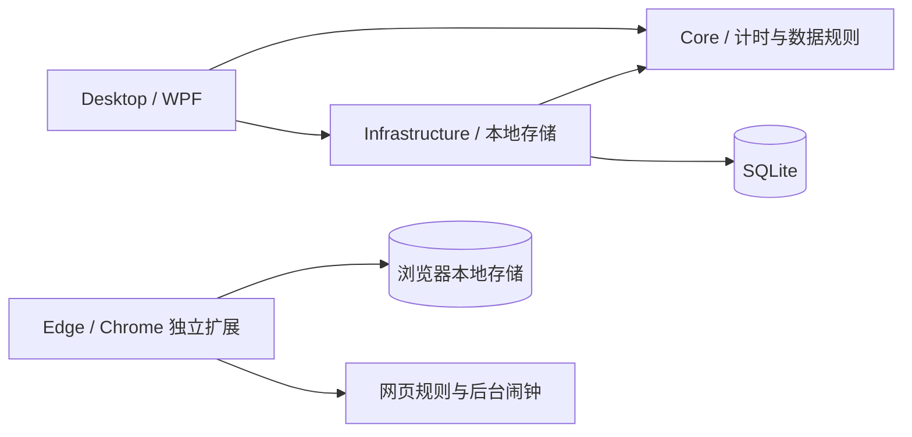

# FocusBloom 工程结构

日期：2026年10月10日

## 依赖方向

桌面应用负责组装具体依赖。Core 不引用 WPF 或 SQLite，包含计时与列表规则；Infrastructure 实现存储接口。界面通过视图模型调用计时核心和存储，窗口布局与计时规则分别维护。浏览器扩展独立保存规则与会话，不依赖桌面程序。

## 已有模块

| 位置 | 职责 |
| --- | --- |
| `Core/Projects` | 项目 ID、名称、分类与颜色 |
| `Core/Focus` | 正／倒计时、暂停、休息、结束状态、专注及暂停区间 |
| `Core/Restrictions` | 网站域名规则、应用放行判断及系统应用例外 |
| `Core/Storage` | 当前项目、记录与设置所需存储接口 |
| `Infrastructure/Storage` | SQLite 建表、项目保存、会话及区间事务保存、设置读写 |
| `Desktop/ViewModels` | 页面状态、命令、输入验证、会话记录保存与重试 |
| `Desktop/Views` | 全屏计时与 WebView2 学习浏览器，共用当前会话及白名单 |
| `Desktop/Presentation` | 视图模型属性通知、按钮命令、配色定义及明暗资源更新 |
| `Desktop/ViewModels/FocusMediaViewModel` | 图片／文字选择、专注图文快照、本机素材偏好与声音控制 |
| `Desktop/Presentation/FocusAudio` | 音频解码、输出、循环与交叉淡化 |
| `Desktop/Views/FocusMediaSettingsView` | 默认折叠的背景／文字／声音素材卡片、收藏、删除、恢复默认及摘录编辑 |
| `Desktop/Views/FocusAudioControls` | 普通页、全屏面板及设置页共用声音控件 |
| `Desktop/ViewModels/FocusTypographyViewModel` | 本机可用字体候选、选择与偏好保存，更新专注字体动态资源 |
| `Desktop/Views/FocusFontSettingsView` | 中文、英文、数字字体卡片及混排预览 |
| `Desktop/Resources/Focus` | 离线背景、环境声、合成音源、提示音及来源目录 |
| `Desktop/Resources` | 共用主题资源与控件样式 |
| `Desktop/Resources/Branding` | 原始 PNG 与多尺寸 Windows ICO，供程序、窗口、托盘及主界面使用 |
| `Desktop/Windows` | 托盘、加载窗口、窗口布局、前台应用监测、应用选择与阻止界面 |
| `Desktop/App` | 数据路径、应用组装、刷新调度、隐藏到托盘与明确退出 |
| `extensions/browser` | 独立 MV3 扩展，计时状态、本地存储、后台闹钟、黑白名单、主题及页面 |

## 计时与数据

状态为准备、专注、暂停、休息、结束。计时读取 `TimeProvider` 的 UTC 时间点，界面每 250 毫秒触发更新；刷新次数不代表经过时间。

暂停到点按预定时刻恢复。倒计时计算扣除暂停后的真实终点；睡眠后首次刷新时，结束记录截止于应结束时刻。休息从会话实际终点开始推进。正计时始终由用户结束，不将 25 分钟解释为自动结束规则。

会话保存开始／结束、项目、计时类型、结束原因和全部专注／暂停区间。有效时长从专注区间求和，不独立维护另一份统计结果。后续每日时间轴与跨天统计从原始区间拆分。时间以 UTC 时间点存储，界面采用本机本地时间显示。

SQLite 表为 `project_folders`、`projects`、`sessions`、`intervals`、`settings`。会话与区间使用一个事务保存，相同会话 ID 重复保存不重复增加记录。保存失败时保留内存记录，禁止新会话覆盖，记录页可重试；明确退出仅在保存成功后执行。

项目按一层文件夹组织，项目的 `Category` 为所属文件夹名称；`project_folders` 保存独立创建的空文件夹。读取文件夹时同时采用已保存文件夹与已有项目分类，原有项目及历史记录保留相同 ID。

会话的 `strict` 字段保存普通／严格模式；已有数据库增加这一列并将历史记录保持为普通模式。应用和网站各自保存黑白名单模式与两种独立列表，新会话复制所选模式及列表形成快照。`FocusTimer.RestrictionsActive` 仅在严格专注和暂停为真，休息与结束为假。

扩展在 `chrome.storage.local` 保存计时偏好、两种网站列表和当前会话。会话包含真实时间点、累计有效专注、暂停／休息终点及网站快照，状态从当前时间计算。后台闹钟唤醒处理自动恢复及到点结束；每次后台启动、面板请求或网页事件先补齐到期状态。工具栏面板、专注标签页与阻止页共用背景服务中的同一会话，状态视图放入 `chrome.storage.session`。

扩展使用动态网络规则处理顶层页面：白名单默认重定向、列表内高优先级放行；黑名单仅重定向列表内域名。已有标签页同步检查；暂停保持限制，休息／结束或关闭限制开关清除规则并恢复阻止页原网址。图片、脚本、样式、接口及下载等资源继续运行。网站配置写入浏览器本地存储，专注／暂停期间拒绝规则编辑。动态规则跨浏览器重开保留，后台恢复时按会话有效期更新。

常亮服务在 UI 线程调用 `SetThreadExecutionState`，专注及暂停期间按开关申请显示与系统运行请求，休息、结束、关闭开关及退出释放。该请求不阻止屏保或系统策略自动锁屏。

应用限制使用 WinEvent 前台事件与界面刷新检查，按真实进程路径放行用户应用。阻止窗口覆盖目标屏幕并取得前台焦点，受限窗口保留位置、尺寸及显示状态，后台进程继续运行。阻止窗口提供返回及结束入口；自有窗口、其拥有的对话框及必要系统界面放行。退出时取消监测并关闭阻止窗口。

学习浏览器使用独立 WebView2 用户目录保存本机登录状态，标签页共用环境与当前白名单。导航及重定向检查主页面，弹窗进入同一环境的新标签页，开始严格专注时检查全部已有标签页。阻止界面隐藏网页控件，解除限制后恢复请求；资源请求保持加载，未放行的嵌入页面取消导航。

界面采用侧栏导航、文件夹列表、项目卡片和独立计时区域。计时方式下拉列表直接选择 `TimerMode`。控件颜色与渐变从应用动态资源取得，配色或明暗切换不会创建新的专注会话。外观偏好保存在本机设置中；跟随系统时响应 Windows 用户外观设置变化。

专注图文在 `MainViewModel.Start` 成功创建会话后选择，同一会话固定保存图片对象与句子。背景和文字分别选择固定或随机，多个候选时避免连续重复；收藏／排除、素材与选择偏好保存为 SQLite 的 `focus.media` 设置。图片文件夹在启动及新专注时读取，图片解码后冻结并关闭文件读取，用户素材保留本机文件引用。背景采用填充适配与暗色遮罩，纯色背景沿用动态主题。

普通页、全屏页与设置页共用同一素材及声音视图模型。NAudio 解码本地音频并用 Windows 输出设备播放，循环末尾与开头进行250毫秒交叉淡化；解码器由实际读取音频的线程创建与持有。播放、暂停、音量与静音独立于计时状态，切换展示方式不重建播放器，退出时释放。应用根据专注／休息阶段变化播放提示音，提示开关与音量保存在本机。

全屏采用覆盖当前显示器完整边界的无边框窗口，内容按状态区分：专注／暂停显示计时视图，休息／未计时显示软件工作区，浏览器明确请求全屏时显示浏览器视图。计时状态切换更新当前全屏内容。浏览器从计时界面进入，同一控件在普通页面与全屏容器间移动，沿用标签页、WebView2 实例及当前网页。离开全屏恢复窗口位置、大小、窗口状态、最小尺寸及置顶偏好。

首次窗口根据当前屏幕工作区取适当尺寸，常规最小尺寸为 900×560；工作区较小时相应降低最小尺寸，并给标题栏和缩放边缘保留空间。`window.layout` 设置保存常规窗口的位置、大小、最大化及置顶状态。窗口关闭时保存，启动时恢复；保存位置不在可用显示器内或屏幕尺寸变化时，将布局调整回工作区。全屏保存其进入前的布局，最小化保留此前的最大化状态。

启动先显示加载窗口，在后台初始化 SQLite，再回到界面线程读取偏好、创建主窗口与托盘。主窗口显示后关闭加载窗口。PNG 与 ICO 编入应用资源，程序图标通过工程的 `ApplicationIcon` 设置嵌入可执行文件；界面共用按显示需要解码的 PNG。

本阶段使用访客数据目录。不引入账号、云同步队列及管理模块的空表；对应功能落地时增加必要的数据结构。

## 下一模块的接入位置

| 模块 | 接入方式与顺序 |
| --- | --- |
| 当前计时浮窗 | 在 Desktop 增加独立窗口，共用当前视图模型及会话，不另存计时数据 |
| 账号与基础同步 | Infrastructure 接入 CloudBase `ap-shanghai`，增加账号隔离、本地变更与同步状态；管理密钥保留服务端 |
| 个人管理 | 按实际功能在 Core 增加数据与规则，Infrastructure 保存原始数据，Desktop 增加页面与共用数据浮窗 |
| 小组 | 账号与基础同步完成后接入；个人结束入口始终有效，心情及复盘只属于个人 |

桌面开始严格模式前保存本次应用及网站模式和列表快照，插件开始时保存自身网站快照；两端规则与会话独立。编辑配置在下一次专注采用，暂停继续限制，休息和结束解除。桌面设置提示在独立扩展中配置外部浏览器网站限制。

## 当前默认值

计时偏好保存默认计时方式和专注模式，启动及每次返回准备状态时采用已保存值；专注页选择用于本次会话。设置页编辑值与已保存值分别维护，点击保存后更新默认值。进行中的会话保持开始时的计时类型、限制模式和白名单，偏好变更在下一次会话采用。

暂停默认 5 分钟、可调整；休息初始为 0，可填写正数开启。暂停和休息不计入专注时长，单次休息结束回到准备界面。初始界面使用莫兰迪雾蓝并跟随系统明暗，设置提供 6 种马卡龙／莫兰迪配色。上述建议默认值随对应交互设计调整，不替代方案中明确的产品规则。
